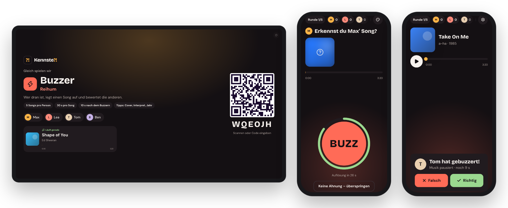
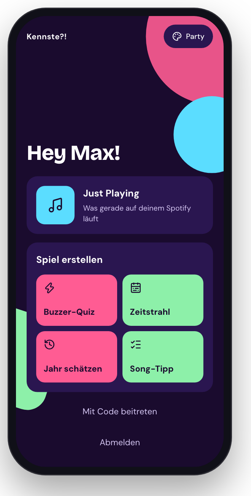
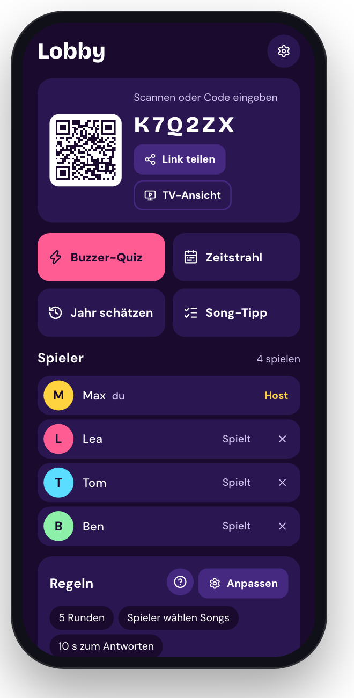
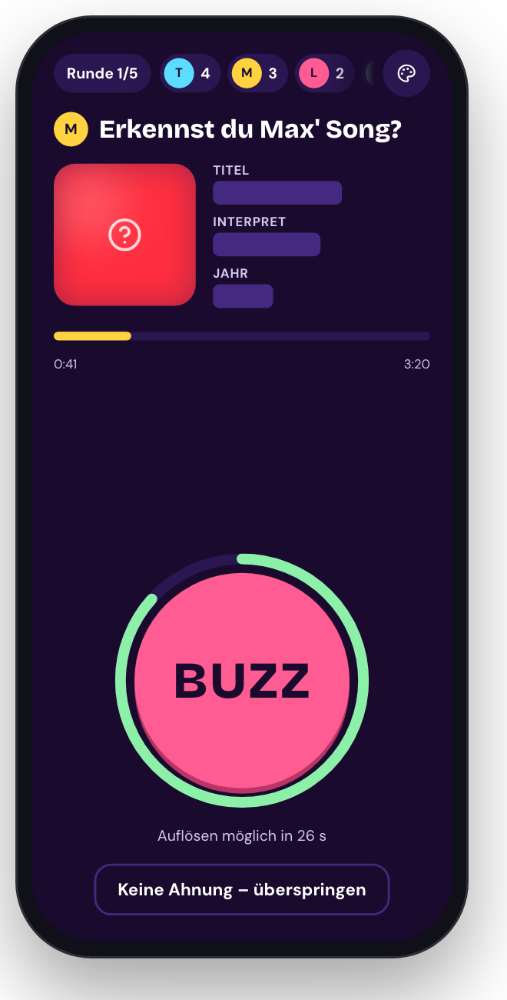
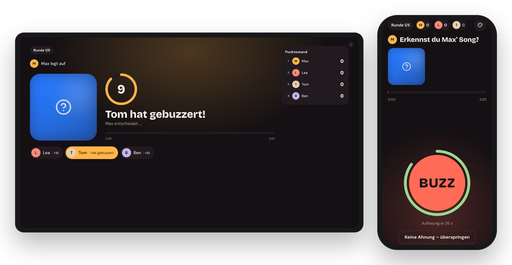
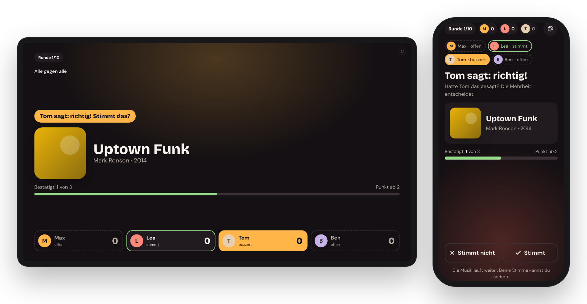
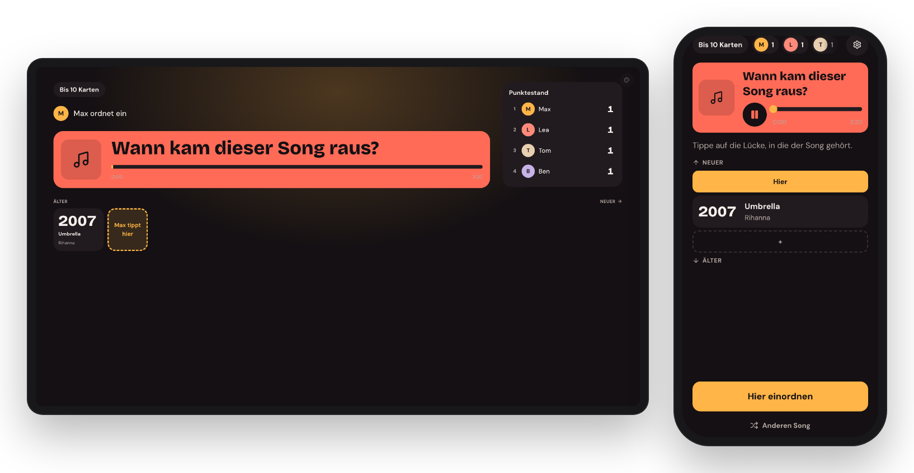
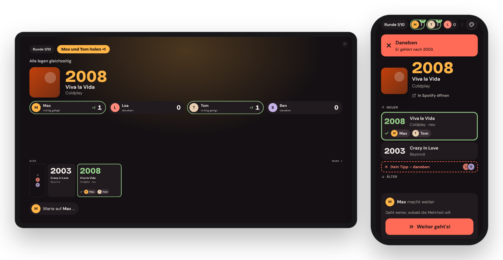
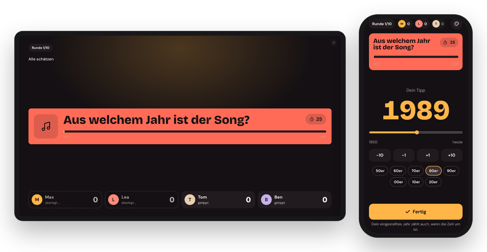
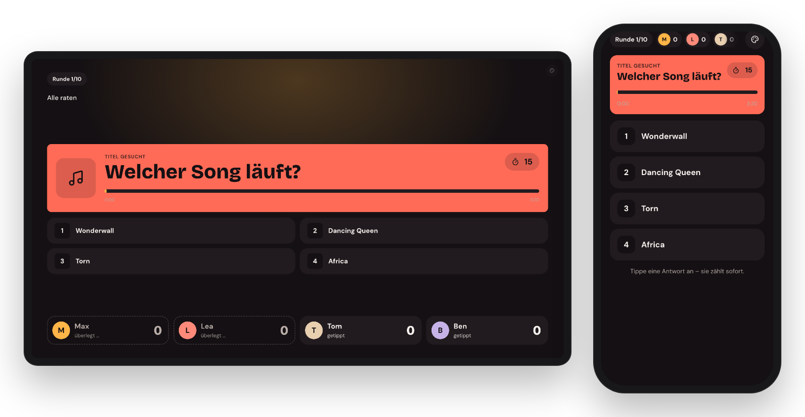

<div align="center">

# Kennste?!

**Hör hin. Rate mit.**

Das Musikquiz für gesellige Runden. Hört gemeinsam Musik, ratet mit und nutzt eure Handys als Buzzer.

<sub>🇬🇧 <a href="README.md">English version</a></sub>



</div>

## So funktioniert's

<table>
  <tr>
    <td align="center" width="33%"></td>
    <td align="center" width="33%"></td>
    <td align="center" width="33%"></td>
  </tr>
  <tr>
    <td valign="top"><b>1. Spiel starten</b><br>Wer die Musik mitbringt, meldet sich mit Spotify an und wählt ein Spiel.</td>
    <td valign="top"><b>2. Alle rein</b><br>Die anderen scannen den QR-Code oder geben den Code ein – ohne App und ohne Account.</td>
    <td valign="top"><b>3. Hören und raten</b><br>Die Musik kommt für alle aus einem Lautsprecher, die Handys sind Buzzer, Tippzettel und Zeitstrahl.</td>
  </tr>
</table>

Ihr sitzt zusammen in einem Raum. Wer mag, holt die **TV-Ansicht** auf Fernseher oder Beamer – dort laufen Runde, Countdown und Punktestand für alle sichtbar mit.

## Die Spiele

<table>
  <tr>
    <td width="50%" valign="top">
      
      <h3>Buzzer-Quiz</h3>
      Reihum legt jemand einen Song auf – per Suche, beim Stöbern nach Jahrzehnt und Genre oder aus einer Playlist. Wer ihn zuerst erkennt, buzzert, und wer aufgelegt hat, entscheidet: richtig oder falsch? Für Profis mit kurzen Ausschnitten und zufälliger Startstelle statt Intro.
    </td>
    <td width="50%" valign="top">
      
      <h3>Alle gegen alle</h3>
      Alle hören denselben Song, jeder kann buzzern. Wer zuerst buzzert, sagt die Antwort laut und sieht erst danach die Lösung. Sagt er „richtig“, läuft die Musik weiter und die anderen stimmen ab – nur wenn die Mehrheit bestätigt, gibt es den Punkt.
    </td>
  </tr>
  <tr>
    <td width="50%" valign="top">
      
      <h3>Zeitstrahl</h3>
      Ein unbekannter Song läuft – aber wann kam er raus? Ordne ihn in deinen Zeitstrahl ein. Liegst du richtig, behältst du die Karte. Oder spielt <i>gemeinsam</i>: ein Zeitstrahl fürs ganze Team, die anderen schlagen Lücken vor, jede falsche Karte kostet ein Leben.
    </td>
    <td width="50%" valign="top">
      
      <h3>Zeitstrahl für alle</h3>
      Ein gemeinsamer Zeitstrahl, und alle legen gleichzeitig und verdeckt. Wer die richtige Lücke trifft, bekommt einen Punkt, die Karte kommt in den Zeitstrahl – und der wird mit jedem Song kniffliger.
    </td>
  </tr>
  <tr>
    <td width="50%" valign="top">
      
      <h3>Jahr schätzen</h3>
      Alle tippen gleichzeitig das Erscheinungsjahr. Volltreffer gibt 3 Punkte, bis 2 Jahre daneben 2, bis 5 Jahre 1. Die Auflösung zeigt alle Tipps auf einem Zahlenstrahl.
    </td>
    <td width="50%" valign="top">
      
      <h3>Song-Tipp</h3>
      Vier Antworten, eine stimmt: Wie heißt der Song, wer singt ihn? Wer richtig liegt, punktet – wer als Erstes richtig liegt, bekommt einen Bonus.
    </td>
  </tr>
</table>

**Und außerdem:** feste Rundenzahl oder „Wer zuerst N Punkte hat“ · Songs selbst aussuchen oder aus einer Playlist · zuschaltbare Tipps (Cover, Titel, Interpret, Jahr) · Zeitlimits · Zuschauen ohne Mitspielen · Laptop-Ansicht mit Tastaturkürzeln · auf den Startbildschirm legen und wie eine App nutzen · am Ende Auszeichnungen und alle Songs, die Songs des ganzen Abends auf Wunsch als eine Spotify-Playlist · zwei Stile: bunt („Party“) oder schlicht („Minimal“) · **Just Playing** zeigt nebenbei, was gerade auf deinem Spotify läuft.

## Was du brauchst

- **Spotify Premium** für den Host – nur sein Konto steuert die Musik.
- **Ein Gerät mit Spotify** für die Musik: Laptop, Box, Fernseher, …
- **Einen Server mit Docker**, auf dem Kennste?! läuft – zu Hause oder im Netz.
- **Mitspieler** brauchen nur ein Handy mit Browser.

> [!NOTE]
> **Warum selbst betreiben?** Spotify erlaubt Apps wie dieser ohne gesonderte Freigabe nur bis zu **5 eingetragene Nutzer** („Development Mode“). Du legst dir deshalb eine eigene, kostenlose Spotify-App an und trägst dich dort ein. Mitspieler melden sich nicht an und zählen nicht dazu.
>
> Eine öffentliche, gehostete Version gibt es nicht und wird es nicht geben: Die [Entwicklerrichtlinien von Spotify](https://developer.spotify.com/policy) erlauben keine Spiele und Quiz-Apps. Kennste?! ist ein privates Hobbyprojekt für den eigenen Spieleabend – wer es betreibt, nutzt dafür seine eigene Spotify-App.

## Loslegen

**1. Spotify-App anlegen**

Im [Spotify Developer Dashboard](https://developer.spotify.com/dashboard) auf *Create app* klicken:
- *Redirect URI:* die Adresse deines Servers plus `/api/auth/callback/spotify`, z. B. `https://kennste.example.de/api/auth/callback/spotify`
- *Which API/SDKs are you planning to use?* → **Web API**
- Danach unter *User Management* dein Spotify-Konto eintragen (und das aller weiteren Hosts).

> [!IMPORTANT]
> Spotify verlangt für die Anmeldung **HTTPS**. Die einzige Ausnahme ist `http://127.0.0.1`.

**2. Starten**

```bash
docker run -d --name kennste -p 3000:3000 --restart unless-stopped \
  -e SPOTIFY_CLIENT_ID=... \
  -e SPOTIFY_CLIENT_SECRET=... \
  -e NEXTAUTH_SECRET=... \
  -e NEXTAUTH_URL=https://kennste.example.de \
  ghcr.io/mg500/kennste:latest
```

`latest` ist die neueste Version; wer Updates selbst steuern will, nimmt eine feste wie `:1` oder `:1.0.0` (siehe [Releases](../../releases)).

*Client ID* und *Secret* stammen aus dem Dashboard, `NEXTAUTH_SECRET` ist ein beliebiger Zufallswert (z. B. `openssl rand -base64 32`), `NEXTAUTH_URL` die Adresse von oben ohne `/api/…`. Lieber mit Docker Compose? [`docker-compose.example.yml`](docker-compose.example.yml) bringt gleich [Caddy](https://caddyserver.com) mit, der das HTTPS-Zertifikat selbst besorgt. Ob der Server läuft, verrät `/api/health` (nutzt auch der Healthcheck des Images).

**Kubernetes?** Es gibt ein Helm-Chart: `helm install kennste oci://ghcr.io/mg500/charts/kennste` – Werte und Hinweise (englisch) in [`charts/kennste`](charts/kennste/README.md).

**3. Spielen**

Adresse öffnen, mit Spotify anmelden, Spiel erstellen – die anderen scannen den QR-Code.

## Gut zu wissen

- **Die Musik startet nicht?** Spiel auf dem gewünschten Gerät kurz selbst einen Song in Spotify an. Ruhende Geräte reagieren sonst manchmal nicht. Kennste?! hilft dabei mit dem Schritt „Musik einrichten“ vor dem Spiel.
- **Nach einem Song läuft das Album weiter.** Spotifys Apps spielen einzelne Songs per Fernsteuerung derzeit nicht zuverlässig ab, deshalb startet Kennste?! sie über ihr Album.
- **Alles läuft im Arbeitsspeicher.** Ein Neustart des Servers beendet laufende Spiele.
- **Fair Play:** Wer die Entwicklertools des Browsers öffnet, kann den Spielstand mitlesen – für ein Partyspiel unter Freunden in Ordnung.

## Mitmachen

Lokal entwickeln, Architektur, Tests und Hinweise zur Spotify-API: siehe [docs/development.md](docs/development.md) (englisch).

## Lizenz

[MIT](LICENSE). Kennste?! ist ein privates Projekt und steht in keiner Verbindung zu Spotify.
