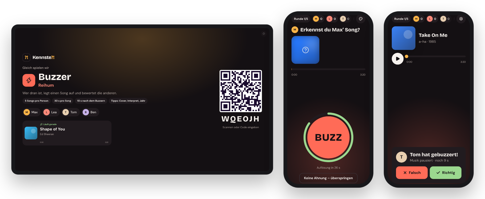
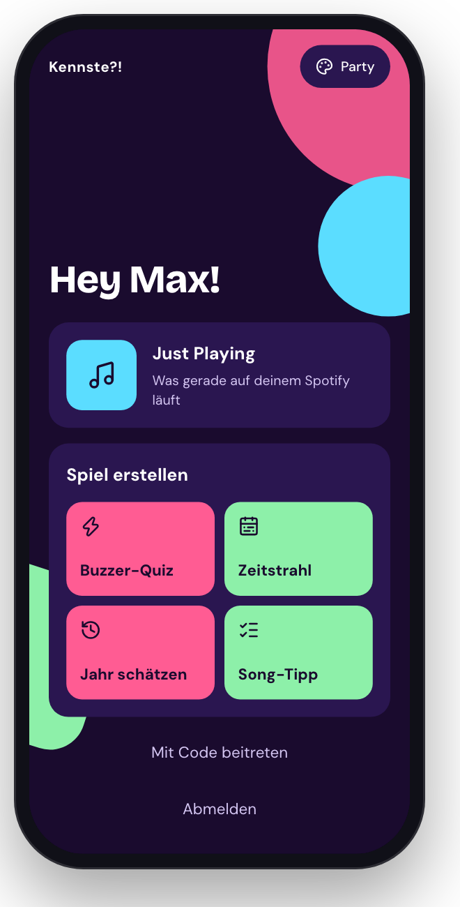
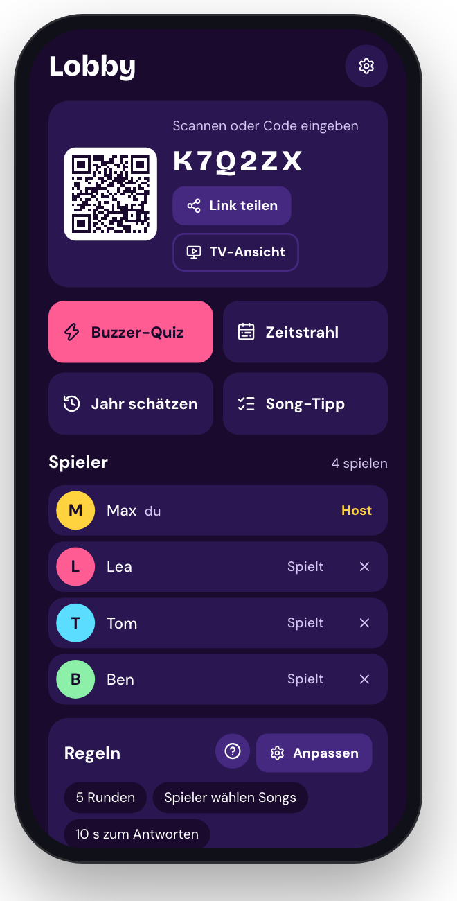
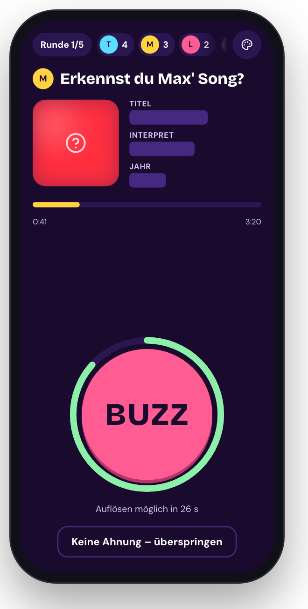
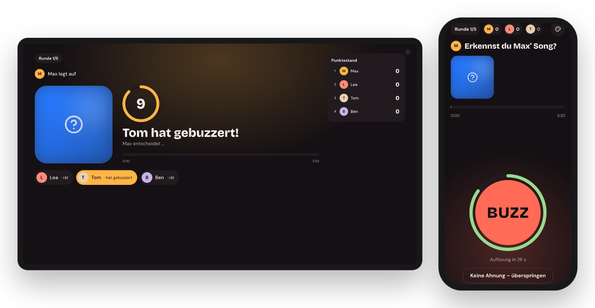
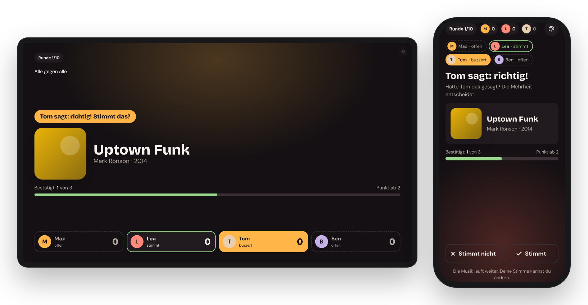
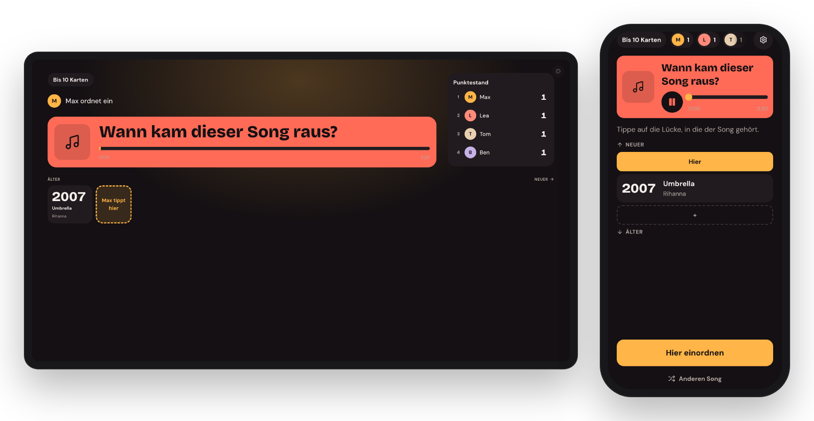
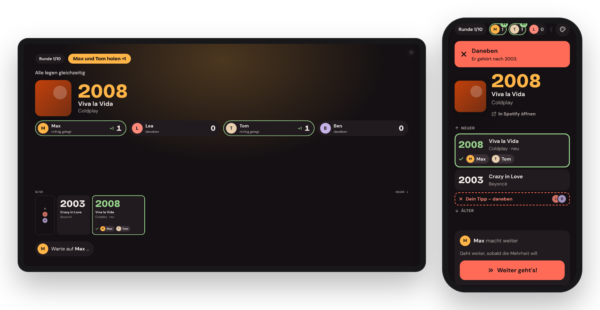
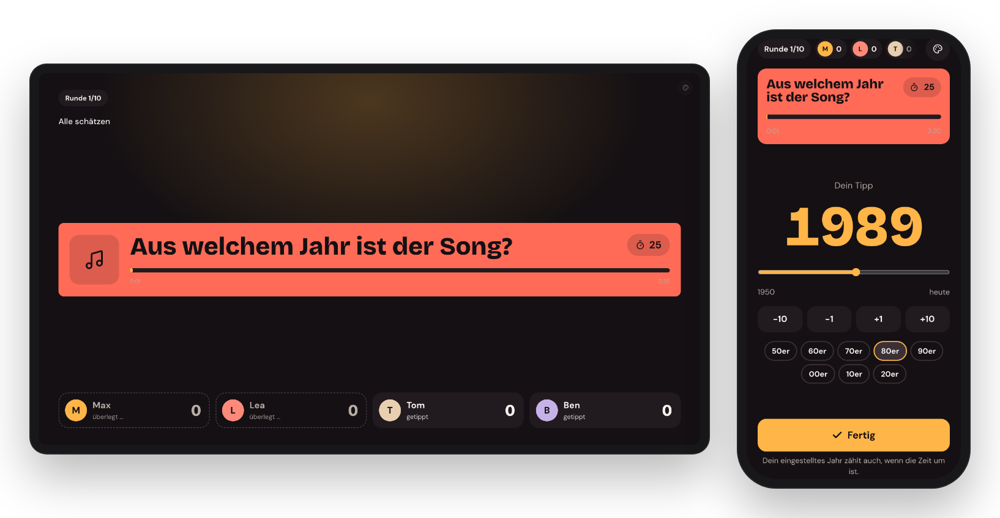
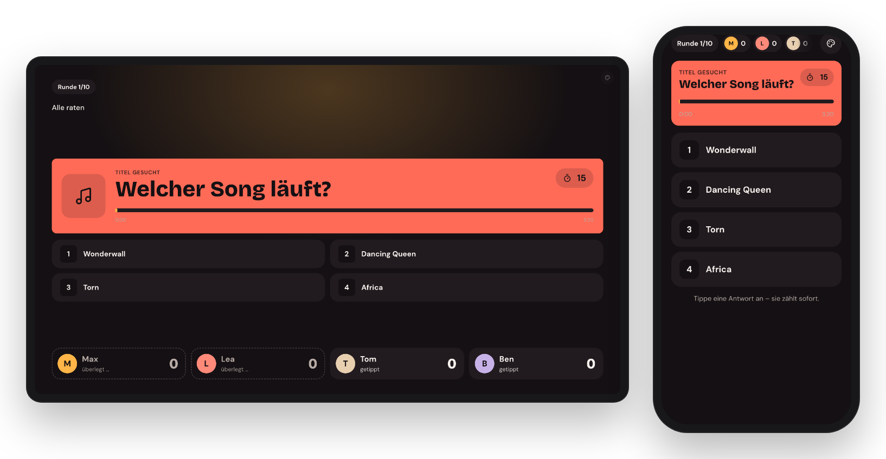

<div align="center">

# Kennste?!

**Listen. Guess along.**

A self-hosted music quiz for game nights. Everyone listens to the same music, guesses along and uses their phone as a buzzer.

<sub><i>“Kennste?!” is German slang for “Know it?!”. The app's interface is in German</i> · 🇩🇪 <a href="README.de.md">Deutsche Fassung</a></sub>



</div>

## How it works

<table>
  <tr>
    <td align="center" width="33%"></td>
    <td align="center" width="33%"></td>
    <td align="center" width="33%"></td>
  </tr>
  <tr>
    <td valign="top"><b>1. Start a game</b><br>Whoever brings the music logs in with Spotify and picks a game.</td>
    <td valign="top"><b>2. Everyone joins</b><br>The others scan the QR code or type in the code – no app, no account.</td>
    <td valign="top"><b>3. Listen and guess</b><br>The music plays from one speaker for everyone; the phones are buzzers, answer sheets and timelines.</td>
  </tr>
</table>

You're all in the same room. Put the **TV view** on a TV or projector if you like – it shows the round, the countdown and the scores for everyone.

## The games

Four games, two of them in several variants – the host picks the variant in the lobby.

<table>
  <tr>
    <td width="50%" valign="top">
      
      <h3>Buzzer · Reihum <sub>(taking turns)</sub></h3>
      Players take turns putting on a song – by searching or browsing by decade and genre. Whoever recognizes it first buzzes, and whoever picked it decides: right or wrong? For pros: short snippets and a random starting point instead of the intro.
    </td>
    <td width="50%" valign="top">
      
      <h3>Buzzer · Alle gegen alle <sub>(everyone vs. everyone)</sub></h3>
      Everyone hears the same song, anyone can buzz. Whoever buzzes first says the answer out loud and only then sees the solution. If they claim “right”, the music keeps playing and the others vote – the point only counts if the majority agrees.
    </td>
  </tr>
  <tr>
    <td width="50%" valign="top">
      
      <h3>Zeitstrahl · Jeder für sich / Im Team <sub>(timeline: on your own / as a team)</sub></h3>
      An unknown song plays – but when was it released? Place it in your timeline. Get it right and you keep the card. Or play <i>as a team</i>: one timeline for the whole team, the others suggest gaps, every wrong card costs a life.
    </td>
    <td width="50%" valign="top">
      
      <h3>Zeitstrahl · Alle gleichzeitig <sub>(timeline: all at once)</sub></h3>
      One shared timeline, and everyone places the song at the same time, face down. Pick the right gap and score a point; the card joins the timeline – which gets trickier with every song.
    </td>
  </tr>
  <tr>
    <td width="50%" valign="top">
      
      <h3>Jahr schätzen <sub>(guess the year)</sub></h3>
      Everyone guesses the release year at the same time. Spot on scores 3 points, up to 2 years off 2, up to 5 years off 1. The reveal shows all guesses on a number line.
    </td>
    <td width="50%" valign="top">
      
      <h3>Vier Antworten <sub>(four answers)</sub></h3>
      Four answers, one is right: what's the song called, who sings it – or both, alternating? Everyone who's right scores – the first to be right gets a bonus.
    </td>
  </tr>
</table>

**Also:** a fixed number of rounds or “first to N points” · pick songs yourselves (buzzer) or play a playlist (all others) · optional hints (cover, title, artist, year) · time limits · watch without playing · a laptop layout with keyboard shortcuts · add it to your home screen and use it like an app · awards and all songs at the end, a look back at the whole evening when the lobby closes, and its songs as one Spotify playlist if you like · three styles: plain dark (“Minimal”, the default), plain light (“Hell”) or warm with a stage light (“Bühne”) · **Just Playing** shows what's currently playing on your Spotify.

## What you need

- **Spotify Premium** for the host – only their account controls the music.
- **A device running Spotify** for the music: laptop, speaker, TV, …
- **A server with Docker** to run Kennste?! – at home or on the internet.
- **Players** only need a phone with a browser.

> [!NOTE]
> **Why self-hosted?** Without a separate approval, Spotify allows apps like this one only **5 registered users** (“Development Mode”). So you create your own free Spotify app and register yourself there. Players don't log in and don't count.
>
> There is no public, hosted version, and there won't be one: [Spotify's Developer Policy](https://developer.spotify.com/policy) doesn't allow games and quiz apps. Kennste?! is a private hobby project for your own game night – whoever runs it uses their own Spotify app.

## Getting started

**1. Create a Spotify app**

In the [Spotify Developer Dashboard](https://developer.spotify.com/dashboard), click *Create app*:
- *Redirect URI:* your server's address plus `/api/auth/callback/spotify`, e.g. `https://kennste.example.com/api/auth/callback/spotify`
- *Which API/SDKs are you planning to use?* → **Web API**
- Then add your Spotify account under *User Management* (and those of any other hosts).

> [!IMPORTANT]
> Spotify requires **HTTPS** for logging in. The only exception is `http://127.0.0.1`.

**2. Run it**

```bash
docker run -d --name kennste -p 3000:3000 --restart unless-stopped \
  -e SPOTIFY_CLIENT_ID=... \
  -e SPOTIFY_CLIENT_SECRET=... \
  -e NEXTAUTH_SECRET=... \
  -e NEXTAUTH_URL=https://kennste.example.com \
  -v kennste_data:/data \
  ghcr.io/mg500/kennste:latest
```

`latest` is the newest version; to control updates yourself, pin one like `:1` or `:1.0.0` (see [Releases](../../releases)).

*Client ID* and *secret* come from the dashboard, `NEXTAUTH_SECRET` is any random value (e.g. `openssl rand -base64 32`), `NEXTAUTH_URL` is the address from above without `/api/…`. The volume `/data` remembers which songs were played, so later games bring new ones first (optional – without it, that's forgotten on every update). Prefer Docker Compose? [`docker-compose.example.yml`](docker-compose.example.yml) comes with [Caddy](https://caddyserver.com), which gets the HTTPS certificate by itself. `/api/health` tells you whether the server is up (the image's healthcheck uses it too).

**3. Play**

Open the address, log in with Spotify, create a game – the others scan the QR code.

## Good to know

- **The music doesn't start?** Briefly play a song in Spotify on the device you want to use. Idle devices sometimes don't respond otherwise. Kennste?! helps with that in the “Musik einrichten” (set up music) step before the game.
- **Songs are started through their album.** Spotify's apps currently don't reliably play single songs by remote control. During a game, Kennste?! pauses at the end of a song, so the album doesn't play on.
- **Games live in memory.** Restarting the server ends running games. Only which songs were played is kept in `/data`.
- **Fair play:** Anyone who opens the browser's developer tools can read the game state – fine for a party game among friends.

## Contributing

Local development, architecture, tests and notes on the Spotify API: see [docs/development.md](docs/development.md).

## License

[MIT](LICENSE). Kennste?! is a private project and not affiliated with Spotify.
